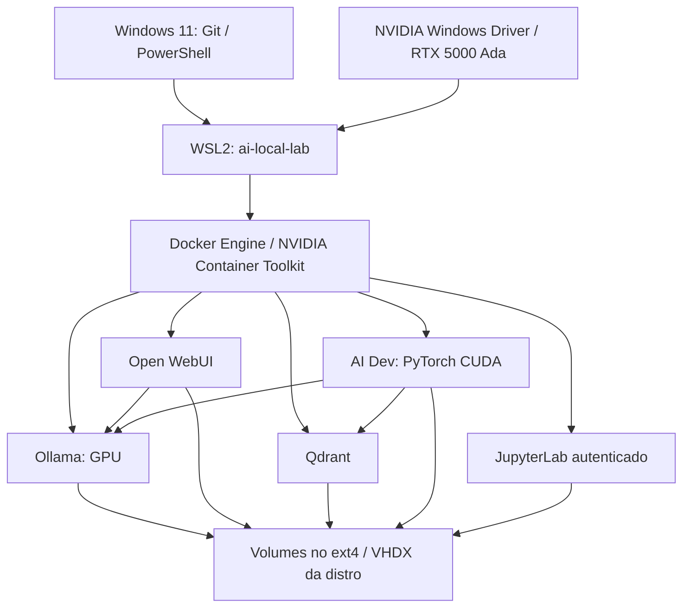

# AI Local Lab — NVIDIA / WSL2

Versão **1.0.0**. Veja o [changelog](CHANGELOG.md) e as [notas da versão](docs/releases/1.0.0.md).

Laboratório descartável para Windows 11, Dell Precision e RTX 5000 Ada 32 GB. O Windows fornece apenas WSL2 e o driver NVIDIA; Docker Engine e a stack de IA ficam na distro exclusiva `ai-local-lab`.

```powershell
git clone https://github.com/marcoleao/ai-lab-nvidia.git
cd ai-lab-nvidia
.\bootstrap.ps1
```

Depois de concluir: **Open WebUI: http://localhost:3000**. Crie a conta administrativa no primeiro acesso. Qdrant: http://localhost:6333. JupyterLab: http://localhost:8888; copie o valor de `JUPYTER_TOKEN` do `.env` para o formulário de login. O script nunca imprime o token.

Se a política de execução bloquear o script, use `powershell.exe -NoProfile -ExecutionPolicy Bypass -File .\bootstrap.ps1` (ou ` .\ai.cmd up`). Isso vale apenas para o processo; não altera a política global.

## Isolamento



Não instala Docker Desktop, Python, CUDA Toolkit, Ollama, Node.js ou SDKs de IA no Windows. O Linux host instala somente ferramentas de operação, Docker e Container Toolkit; bibliotecas Python ficam nos containers. Nenhum driver NVIDIA Linux é instalado. Não muda a distro WSL padrão, `.wslconfig` global nem Windows Firewall.

## Pré-requisitos e primeira execução

- Windows 11 x64, virtualização habilitada no firmware e PowerShell 5.1 ou superior.
- Driver NVIDIA Windows funcionando em `nvidia-smi`; o bootstrap valida e interrompe em caso de falha, sem substituir o driver.
- Internet para Canonical, Microsoft, repositórios Docker/NVIDIA, registries, PyPI e Ollama. Git já usado para clonar o projeto.
- Pelo menos 100 GB livres no disco da distro; reserve **150–200 GB** para imagens, os quatro modelos e folga. Os modelos não são carregados todos simultaneamente.
- WSL moderno com systemd. Se não estiver instalado, execute o mesmo bootstrap em PowerShell administrador. Ele usa `wsl --install --no-distribution --web-download`, pede reboot e retorna **3010**. Após reboot, execute o comando novamente na sua conta normal. Não importa a distro usando uma conta administrativa diferente.

O bootstrap verifica host, baixa rootfs Ubuntu 24.04 LTS com SHA256 auditada e fixada no Git, importa somente a distro configurada, ativa systemd, reinicia somente essa distro se necessário, instala Docker/Toolkit dos repositórios oficiais, sincroniza fonte, sobe containers, baixa modelos ausentes e roda doctor/smoke. A primeira execução pode levar bastante tempo; os quatro downloads de modelos e a imagem PyTorch são grandes. Erros preservam etapas concluídas e informam `FAILED STEP`, `CURRENT STATE` e `HOW TO RETRY`.

## Comandos

Use `.\bootstrap.ps1 <comando>` ou `.\ai.cmd <comando>`. Não é necessário instalar o wrapper no PATH; no diretório do projeto o PowerShell exige o prefixo `.\`. Se escolher adicionar **o diretório deste repositório** ao PATH por conta própria, poderá usar `ai up`.

| Comando | Comportamento |
| --- | --- |
| sem argumento / `up` | Convergir configuração, iniciar, baixar ausentes, validar |
| `up core` | Ollama e Open WebUI; imagem dev usada para smoke GPU |
| `up rag` | Core + Qdrant |
| `up dev` | Core + AI Dev + Jupyter |
| `up all` | Core + RAG + Dev |
| `up --ephemeral` | Dados WebUI/Qdrant/Jupyter em tmpfs |
| `down` | Parar/remover containers e rede; preservar volumes/imagens/distro |
| `restart` | Reiniciar stack selecionada e validar |
| `status` | Containers, GPU/VRAM, modelos, disco, volumes e endpoints |
| `doctor` | Diagnóstico host, WSL2, daemon, GPU, modelos, serviços selecionados |
| `test` | Inferência Ollama, VRAM, operação CUDA, WebUI, Qdrant e Jupyter |
| `logs [serviço] [-f]` | Últimas 100 linhas; follow opcional |
| `models` | Listar instalados e baixar declarações ausentes |
| `shell` | Bash do usuário lab na distro exclusiva |
| `dev` | Ativar dev e abrir Bash no container GPU com Python/uv prontos |
| `jupyter` | Ativar dev/Jupyter e informar URL sem token |
| `reset [--yes]` | Remover volumes da aplicação e recriar; preservar modelos por padrão |
| `destroy [--yes]` | Remover containers/rede/volumes da aplicação; manter distro/cache/modelos |
| `rebuild` | Build sem cache, recriar, doctor/smoke |
| `update` | Pull das tags configuradas, rebuild com pull, recriar, atualizar modelos |
| `nuke [--yes]` | Confirmação `NUKE`, unregister da distro própria e remoção de artefatos |

`reset`/`destroy` pedem `DELETE`. `--yes` dispensa a confirmação dos comandos destrutivos para automação consciente. `--ephemeral` é aceito em `up`; a seleção fica registrada na distro para comandos seguintes. `up` novamente sem a opção volta à persistência. Profiles `agents` e `observability` são reservados; não instalam serviços adicionais.

## Configuração e modelos

Edite [config/lab.yaml](config/lab.yaml), [config/models.yaml](config/models.yaml) e [config/versions.env](config/versions.env), depois rode `up`. `lab.yaml` usa deliberadamente um subconjunto YAML plano: chaves conhecidas, escalares, booleanos e lista inline de profiles. Isso permite bootstrap com PowerShell nativo, sem instalar parser/runtime no Windows. `models.yaml` aceita somente o schema mostrado no arquivo, sem anchors ou execução de expressões.

Modelos iniciais: `qwen3:14b`, `gpt-oss:20b`, `qwen3-coder:30b`, `gemma3:27b`. `up` ignora modelos presentes; `update` repuxa as tags declaradas. Tags de modelos podem mudar no registry; para replay exato arquive/exporte o volume e registre os digests retornados pela API. O smoke usa um modelo instalado e contexto pequeno; contexto grande ou outros workloads concorrentes podem ultrapassar 32 GB. Ollama limita paralelismo e modelos carregados a um.

As imagens têm tags fixas, centralizadas em `versions.env`. PyTorch **2.7.1 / CUDA 12.6 / cuDNN 9** vem da imagem oficial; uv **0.8.22** instala o lock Python 3.11 em venv com acesso ao PyTorch da base. A substituição de dependência `torch; sys_platform == 'never'` impede duplicar/reinstalar torch por dependências transitivas; build e doctor verificam a base. O lock é específico para Linux/Python 3.11. Não use esse override se migrar para uma imagem sem torch. Veja [GPU](docs/gpu.md) e [bootstrap](docs/bootstrap.md).

Downloads interrompidos recebem até `model_pull_attempts` tentativas (padrão 3), com espera inicial `model_pull_retry_delay_seconds` (padrão 5 s), dobrada a cada nova tentativa. Cancelamento e comandos ausentes não são repetidos. Se a sessão inteira do WSL for interrompida, execute `up` novamente: não há retentativa Windows que recrie a distro ou apague o cache. Uma interrupção não exige reset/nuke.

O `doctor` aguarda serviços em `starting`/`restarting` até o prazo compartilhado de `health_timeout_seconds`; serviços ausentes, parados ou unhealthy continuam sendo erros. Modelos não concluídos são reportados com orientação de retomada. O smoke usa o primeiro modelo declarado, evitando selecionar incidentalmente o último/grande modelo instalado. Em GPUs de 16 GB, comece com `qwen3:14b` e contexto pequeno; modelos maiores podem usar CPU ou exceder memória.

Execuções `up`, `update`, `rebuild`, `reset`, `models`, `doctor` e `test` gravam a saída Linux em `/opt/ai-local-lab/.runtime-logs/`, com arquivos privados preservados no próximo sync. Não gravam `.env` nem o conteúdo de `compose config`; logs arbitrários dos serviços via `ai logs` não são capturados nesse mecanismo. `nuke` elimina esses logs junto com a distro.

## Código, desenvolvimento e RAG

O Git Windows é a fonte de verdade. O bootstrap copia arquivos para `/opt/ai-local-lab` no ext4 da distro; o container monta `/opt/ai-local-lab/workspace` em `/workspace`. Workloads, modelos e caches não rodam em `/mnt/c`. A sincronização do workspace não apaga arquivos criados no Linux; arquivos Windows de mesmo nome prevalecem. Secrets, `.git` e estado gerado são excluídos. A cópia de implantação converge com remoção de arquivos obsoletos.

Mudanças de infraestrutura devem ser feitas neste repositório e aplicadas com `up`/`rebuild`. Antes de resetar ou remover a distro, copie código/notebooks criados dentro dela para o Git Windows; essa cópia de trabalho não é backup nem sincronização bidirecional. Pode acessar os arquivos pelo Explorer em `\\wsl$\ai-local-lab\opt\ai-local-lab\workspace`. Jupyter abre `/notebooks` (volume dedicado); `/workspace` também está disponível no container.

No ambiente dev: `OLLAMA_HOST=http://ollama:11434`, `QDRANT_URL=http://qdrant:6333` e `QDRANT_API_KEY` no ambiente. Qdrant fornece o banco vetorial; integração de uma pipeline RAG e configuração de coleções são responsabilidade do código versionado da aplicação. A mera subida do banco não configura automaticamente o RAG do WebUI.

## Persistência, remoção e segurança

A distro fica em `%LOCALAPPDATA%\ai-local-lab\distro\ext4.vhdx`; altere `distro_directory` **antes** da primeira execução. O último componente do caminho deve corresponder a `distro_name`. Uma distro já existente sem marcador é recusada; nunca será adotada nem removida automaticamente. Nome/caminho/marcador interno e registro WSL2 são conferidos em cada operação.

Volumes Docker: `ai-local-lab_ollama_models` (externo ao ciclo `compose down -v`), `ai-local-lab_open_webui_data`, `ai-local-lab_qdrant_data`, `ai-local-lab_huggingface_cache`, `ai-local-lab_jupyter_data`. Todos ficam no VHDX; `preserve_models: false` permite remover também modelos em reset/destroy. No modo ephemeral, WebUI/Qdrant/Jupyter usam RAM; `ephemeral_models: true` coloca modelos em tmpfs também, exigindo RAM suficiente e novo download após stop. O workspace e o cache Hugging Face continuam persistentes; tmpfs não é apropriado para grandes downloads de modelos.

Os binds padrão são 127.0.0.1; Ollama não publica porta e gRPC não publica por padrão. `allow_lan_access: true` seleciona 0.0.0.0 conscientemente; não abre firewall automaticamente. Ollama não tem autenticação nativa: não exponha sua API a redes não confiáveis. Qdrant requer API key, Jupyter requer token, WebUI mantém autenticação. Secrets de 256 bits são gerados no `.env`, ignorados pelo Git, protegidos por ACL Windows e copiados com modo 0600 no Linux. Logs de bootstrap em `.logs/` contêm eventos e timestamps, não secrets; logs dos serviços são exibidos sob demanda. O grupo Docker equivale a acesso root **à distro**. Containers têm acesso ao workspace e rede externa para downloads; este isolamento operacional não constitui sandbox para executar código hostil.

```powershell
.\bootstrap.ps1 nuke
# digite NUKE
.\bootstrap.ps1
```

`nuke` remove a distro própria, rootfs/cache do diretório gerenciado, `.env`, `.logs`, `.state` e `.cache`. Mantém repositório IaC, plataforma WSL, driver NVIDIA, Git, PowerShell e todas as outras distros. Não remove programas preexistentes que não foram instalados pela solução. Veja [lifecycle](docs/lifecycle.md), [segurança](docs/security.md) e [recuperação](docs/disaster-recovery.md).

## Validação e manutenção

```powershell
.\tests\validate.ps1
.\ai.cmd doctor
.\ai.cmd test
```

Na distro, `bash /opt/ai-local-lab/scripts/linux/quality-gates.sh` valida Bash/shellcheck disponível, Compose, instalação frozen do lock, Python/YAML/TOML, contratos com mocks e build. CI executa esses gates em Linux e as verificações PowerShell em Windows. CI comum não possui GPU: testes GPU/rede/modelos são executados pelo bootstrap na workstation.

Edite versões de forma deliberada; `update` não escolhe automaticamente `latest`, não altera o driver/Windows nem executa `dist-upgrade`. Para atualizar o lock, use uv em container Linux ou no container dev, atualize `pyproject.toml`, rode `uv lock` e copie **pyproject + lock** de volta para Git antes de `rebuild`. Pin por digest de imagens e SHA256/rootfs com URL datada é recomendado para replay byte a byte. Pacotes Docker/Toolkit são convergidos dos repositórios stable oficiais; o projeto não garante replay byte a byte desses pacotes apt.

Limites de validação desta implementação: PowerShell/Bash e guardas são verificáveis sem provisionamento. Build Docker, instalação frozen do lock e cenários completos bootstrap → nuke → bootstrap precisam passar em uma máquina com WSL/Docker/GPU disponíveis. Consulte [registro de validação](docs/validation.md) e [troubleshooting](docs/troubleshooting.md); não trate uma validação estática como prova de GPU funcionando.
