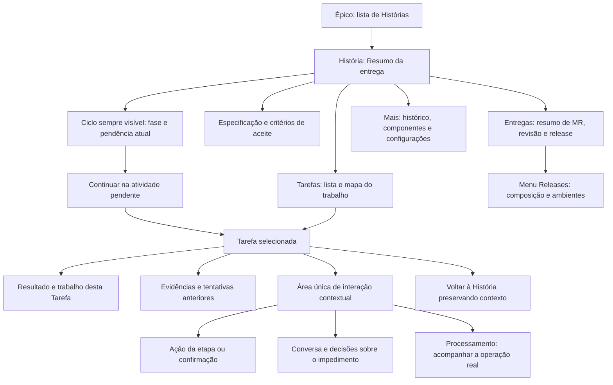

# História, Tarefas e interação: diagnóstico e plano de evolução

Data: 23/10/2026. **Protótipo aprovado pelo usuário; implementação publicada no portal real em `http://localhost:3310`.** O diagnóstico inicial consolidou auditoria de código, consulta somente de leitura à História usada no teste e três agentes: UX de navegação, UX de interação e arquitetura de execução. O plano e seu diagnóstico histórico estão preservados abaixo, junto ao [backlog funcional](plano-portal-sdlc-2026-10-20.md), à [redefinição da interface](redefinicao-interface-2026-10-22.md) e às decisões sobre releases.

Validação final: **154 testes de API/domínio e 39 jornadas Chromium passaram** em bancos descartáveis. Os quatro ensaios que exigem GitLab externo não foram executados nesta entrega. Build de produção passou; a imagem preparada corresponde às fontes. O ensaio da migração numa cópia do backup e a conferência posterior no banco real preservaram os 29 itens, a execução, as três verificações, releases e conversas existentes. A inspeção do portal publicado confirmou as integrações configuradas, navegação desktop/celular e o dashboard de Atividades, com zero escritas do navegador. A História do OMDB continua exigindo novo Code Review para a revisão corrigida; nenhuma revisão, correção, aprovação ou operação de merge foi disparada como parte dessa inspeção.

Atualização após autorização para avançar: UX-H2 foi representada no [protótipo independente](../prototypes/navigation-v1/README.md), em `http://localhost:3311/#/story/story-consulta/overview`. História macro, detalhe de Tarefa, interação única e processamento possuem cenários fictícios navegáveis. A revisão de UX cobriu desktop e celular. O usuário aprovou essa direção, autorizou sua implementação no portal real e escolheu todas as métricas sugeridas. Os contratos, executores, projeção e interface reais passaram a compor a entrega publicada; o protótipo continua separado para consulta.

Verificação do protótipo: 47 jornadas anteriores e 12 novas passaram, em rodadas de regressão e validação final. Incluem correções sucessivas com novas revisões, invalidação das verificações, histórico preservado, CRUD de Tarefa manual, associação de release e ciclo review/scan/merge sem conclusão indevida da História. Não houve execução desses cenários sobre os registros do usuário.

### Recorte implementado no portal real

A navegação da História apresenta o resumo e a próxima ação; o detalhe de Tarefa reúne escopo, resultados, tentativas e eventos. A projeção única consulta os executores existentes e preserva confirmação, autorização, idempotência e conversas. A interface distingue espera de processamento, espera humana, último evento e heartbeat, sem mostrar pensamento privado nem simular avanço.

O modelo aditivo `WorkActivity / WorkAttempt / WorkEvent / WorkTaskLink` vincula especificação, codificação, Code Review, Security Scan e merge a Tarefas reais. Tarefas técnicas são criadas uma única vez quando o processo é solicitado. As planejadas exigem escolha explícita de escopo e condição de conclusão: publicação comprovada pode concluir vínculos `publish_code`, enquanto `manual_evidence` mantém a validação própria. Não há conclusão retroativa de Tarefas antigas pela simples existência de MR.

Status operacionais não alteram o escopo aprovado. O cálculo compartilhado preserva assinaturas legadas e continua recusando mudanças reais de conteúdo ou componente. Após alteração de escopo de uma entrega publicada, o comando confirmado de novo planejamento cria outra execução e exige novo G1, mantendo os artefatos anteriores. Operações ativas impedem essa substituição. Decidir uma capacidade encerra a espera da conversa anterior antes de revisar a especificação, sem concluir a codificação.

A seleção completa de Tarefas possui token próprio `expectedLinksVersion`; a comparação e gravação são serializadas pela atividade, evitando perda de seleção entre abas. Atualizações operacionais de vínculos não invalidam o G1. As tentativas registram fila e processamento por etapa, com proteção por revisão/lease para rejeitar resultados tardios.

As métricas aprovadas incluem fila, processamento, espera humana, resolução de impedimentos por categoria, retomadas, vínculos e reaberturas nas quatro semanas, mantendo filtros e regras de ausência de amostra. As verificações automatizadas usam bases descartáveis; nenhum cenário executa correção, revisão ou merge no MR do usuário como preparação da demonstração. A validação humana da interface publicada continua sendo a próxima confirmação de uso.

Este recorte não implementa executores de teste, candidatas de release, promoção QA/HML/PRD ou conclusão automática da História. Esses itens e as regras de imutabilidade permanecem no plano funcional.

## 1. Diagnóstico confirmado

Retrato anterior à implementação: as evidências abaixo explicam a mudança e permanecem registradas para auditoria.

| Problema | Evidência atual | Consequência |
| --- | --- | --- |
| O topo cresce e deixa de acompanhar a navegação | `apps/web/app/execution-navigation.css:6` retira `position:sticky` quando existe QualityControl. Os painéis de qualidade, merge, achados e confirmações entram no topo por StoryExecution → MergeControl → QualityControl | A situação e a próxima ação somem ao rolar; o breadcrumb se transforma em página de execução |
| Há representações concorrentes do processo | `story-execution.tsx` mantém um ciclo de especificação a MR; `quality-control.tsx` acrescenta outro; a História tem seu próprio status | Publicação concluída pode parecer conclusão de toda a História; não há leitura contínua de fase e atividade |
| A ação principal compete com consultas e ações futuras | `story-execution.tsx` renderiza revisão da especificação e consulta da entrega antes das ações de continuidade; `portal.tsx` também destaca criar Tarefa | O usuário precisa decidir qual botão realmente continua seu trabalho |
| Há várias entradas de conversa | O Assistente global recebe contexto do Projeto; ExecutionDiscussion trata da execução; MergeDiscussion trata do merge; QualityCheck não tem conversa contextual própria | Uma pergunta sobre um achado pode ir para o planejamento ou para o agente de merge |
| Atualização da tela não prova atividade do executor | Há polling e `updatedAt`, mas não há contrato de progresso/heartbeat exposto. A LLM usa `stream:false` em `apps/api/src/llm.ts` | É difícil distinguir fila, espera de resposta, processo sem sinal e falha de comunicação |
| As Tarefas não participam da execução | `execution.ts:24-27` lê as Tarefas para snapshot/fingerprint. StoryExecution, QualityCheck e MergeOperation não têm vínculo operacional com elas | Coding/review/correção avançam sem criar ou atualizar Tarefas correspondentes |
| Automatizar Tarefas sem rever versionamento quebraria o fluxo | O fingerprint inclui a lista de Tarefas e suas versões; G1 e retomada verificam essa assinatura | Criar uma tarefa de review ou atualizar uma tarefa operacional poderia invalidar o planejamento aprovado |

### Exemplo real consultado

Na História **Buscar filmes no OMDB com base em um título informado**, as Tarefas **Criar interface para busca de filmes** e **Integrar com a API OMDB** permanecem `TO DO`, versão 1, apesar das publicações de código. Não existe Tarefa de Code Review vinculada às verificações executadas.

O último Code Review terminou com três achados e sem erro de execução; um achado está relacionado a credencial. Depois houve solicitação de correção pelo usuário e publicação de outro commit. O último parecer pertence ao commit anterior; a nova revisão ainda não tem Code Review aprovado. Esse caso precisa aparecer como **CODING · correção publicada; CODE REVIEW precisa ser refeito**, acompanhado da pendência correspondente. A existência de `succeeded/completed` no registro de publicação não conclui a História.

“Problema com credencial” deve ter duas classificações distintas: achado no código/configuração do produto e falha de autenticação da integração. A próxima ação depende dessa classificação; a interface não deve encaminhar ambas automaticamente para alterar código.

## 2. Modelo de informação proposto

**História é o resumo da entrega. Tarefa é a unidade de trabalho. Atividade descreve o passo em execução. Tentativa guarda a execução e seu resultado para uma revisão específica.**

| Informação | Onde fica | Exemplo |
| --- | --- | --- |
| Objetivo, critérios de aceite e fase macro | História | Buscar filmes; `CODE REVIEW` |
| Trabalho planejado, tipo, escopo, dependências e condição de conclusão | Tarefa | Integrar API OMDB; revisar código |
| Andamento observável dentro do trabalho | Atividade vinculada à Tarefa | Obter contexto; aguardar modelo; publicar revisão |
| Fila, execução, decisões, erros e resultados de um ciclo | Tentativa vinculada à atividade e à revisão | Segunda revisão do commit X, bloqueada por três achados |
| Gate e autorização humana | Registro de decisão vinculado à atividade/Tarefa | G1 aprovado por pessoa e data, para escopo definido |
| Pacote e promoção entre ambientes | Release do Sistema | Candidata imutável; QA/HML/PRD e evidências compartilhadas |

Preservar os status definidos pelo usuário: História `SPECIFICATION / APPROVED / CODING / CODE REVIEW / SECURITY SCAN / TESTING / UAT / PRODUCTION / COMPLETED`; Tarefa `TO DO / DOING / DONE`. Merge é uma atividade de integração entre os controles de código e as etapas seguintes, não um novo status da História.

Estados operacionais como `QUEUED`, `RUNNING`, `WAITING INPUT`, `WAITING APPROVAL`, `BLOCKED`, `FAILED` e `STALE` são apresentados separadamente. Não acrescentá-los ao status da Tarefa. Exemplo: **CODE REVIEW · Tarefa DOING · tentativa BLOCKED · aguardando correção**. Uma tentativa bloqueada terminou, mas o trabalho de obter revisão aceita continua pendente.

### Uma fonte para situação e próxima ação

Definir uma projeção de jornada produzida pelo backend, em vez de montar a situação no navegador por callbacks de codificação, qualidade e merge. Essa projeção reúne fase, revisão vigente, Tarefas/atividades, tentativa atual, último evento, condição operacional, impedimento categorizado, papel que pode resolver, ação primária e alternativas com motivos e efeitos. A API continua autorizando e validando cada comando; mostrar um botão não concede permissão.

Primeiro, reconciliar solicitações incertas e identificar operações já ativas, para evitar reenvios. Histórico antigo não substitui o estado da revisão atual. A regra deve permitir consultar outra Tarefa sem perder a indicação da atividade que exige atenção na História. Se várias Tarefas estiverem ativas, mostrar resumo e prioridades/dependências, sem fingir que toda a História é uma única chamada de IA. O detalhe do recurso ocupado deve respeitar a visibilidade do usuário; espera por outra execução não autoriza expor seus dados.

Após resolver solicitações incertas e identificar operações já ativas, priorizar impedimento obrigatório da etapa → decisão humana aplicável → próxima dependência executável. Havendo alternativas independentes equivalentes, apresentar uma escolha explícita, sem selecionar uma Tarefa arbitrariamente pela data. Separar “Situação atual da História” de “Você está consultando Tarefa/tentativa X”. A área de interação explicita seu alvo; consulta histórica não pode executar correção/aprovação de revisão antiga nem usar silenciosamente o contexto de outra Tarefa.

## 3. Árvore de navegação para validar



O desenho representa destinos de consulta, não múltiplos centros de comando. A faixa compacta contém a entrada para **a mesma área de interação**, não outra coleção de botões. Na História, “Continuar em Code Review” abre a Tarefa correspondente já na pendência atual. Ao abrir essa área, não manter um segundo botão primário concorrente no cabeçalho.

### Disposição visual

```text
Sistemas > Sistema > Projeto > Épico > História [> Tarefa]
HISTÓRIA · fase atual · atividade/pendência · quem precisa agir
Ciclo compacto: anteriores | etapa atual | próximas etapas
─────────────────────────────────────────────────────────────
Conteúdo consultado                  Área única de interação
                                     Contexto: História/Tarefa
História: resumo e mapa de Tarefas    Situação e próximo passo
ou                                   Uma ação prioritária
Tarefa: descrição, resultado          Conversa/pergunta/decisão
e evidências sob demanda             Operação em processamento
─────────────────────────────────────────────────────────────
```

- **Sempre visível:** localização, fase da História, atividade/Tarefa atual, impedimento vigente e quem deve agir. Mesmo ao consultar uma tentativa antiga, manter “Histórico do commit X” separado da situação atual.
- **Conteúdo da História:** resumo, critérios resumidos, mapa das Tarefas, pendências agregadas e resumo da entrega. Não embutir chats, logs extensos, listas de achados ou formulários de merge no cabeçalho.
- **Mapa de Tarefas:** distinguir trabalho planejado de tarefas técnicas do processo, com filtros “aguardando minha ação”, “em andamento”, “impedidas” e “todas”. Organizar por dependência/atividade, sem transformar cada chamada de ferramenta em um novo item de backlog.
- **Conteúdo da Tarefa:** descrição/escopo, resultado atual, subetapas observáveis, evidências e tentativas. Achados e diff entram nesse nível; detalhes técnicos são expansíveis.
- **Comando único:** confirmações, G1, pedidos à IA, resposta de impedimento, retomada e merge usam um único componente contextual, com uma ação primária por decisão. Não apenas acrescentar um quarto chat aos três existentes.
- **Ordem de prioridade:** pendência/erro atual → ação necessária → alternativas secundárias → administração. “Editar”, criar Tarefa e rever documento antigo não concorrem com a continuidade. Consultar documento, filtrar lista ou abrir evidência são navegação, não outro ponto de execução.
- **Celular:** manter resumo compacto no topo; a mesma área de interação abre como página/painel amplo. Não prender um chat ou documento inteiro no cabeçalho nem cobrir o conteúdo com barras grandes.
- **Identidade visual:** preservar cores, tipografia, componentes e funções do produto atual. Cor nunca é o único indicador; incluir texto, ícone, foco e navegação por teclado.

As abas de primeiro nível propostas são **Resumo, Tarefas, Especificação e Entregas**. Histórico e configurações continuam acessíveis em “Mais”. O ciclo fica acima do conteúdo, inclusive ao navegar por essas abas. A tarefa abre por URL própria, com retorno, recarga e link direto; a lista preserva filtros e posição.

O Assistente de planejamento permanece no Projeto. Na História/Tarefa, a superfície de interação aponta explicitamente seu contexto. Acesso ao planejamento do Projeto é navegação deliberada; mensagens sobre review não são enviadas silenciosamente a esse chat.

## 4. Ciclo e botões por etapa

```mermaid
flowchart LR
    S[SPECIFICATION: preparar e revisar] --> G[G1: decisão humana]
    G --> A[APPROVED]
    A --> CO[CODING: executar Tarefas de código]
    CO --> CR[CODE REVIEW]
    CR --> SEC[SECURITY SCAN]
    SEC --> ME[Integrar MR: GitLab ou assistente]
    ME --> TE[TESTING: evidência de testes reais]
    TE --> UA[UAT: homologação da candidata]
    UA --> PO[PRODUCTION: mesma candidata aprovada]
    PO --> CE[COMPLETED: critérios finais atendidos]
    CR -->|achados e correção solicitada| CO
    SEC -->|achados e correção solicitada| CO
    CO -->|novo commit: controles refeitos| CR
```



Esse é o ciclo conceitual completo, não a declaração de etapas já implementadas. QA/HML/PRD e pacotes continuam seguindo o backlog e as regras de release; botões dessas operações só serão habilitados quando existirem executores reais. Aprovação técnica não autoriza avançar automaticamente todos os estados.

| Situação | O que a História mostra | Tarefa/área de trabalho | Próxima ação prioritária |
| --- | --- | --- | --- |
| Escopo ainda incompleto | `SPECIFICATION` e pendência concreta | Especificação/critério faltante | Completar especificação |
| Preparação em fila ou em execução | Fase, atividade, agente e estado operacional | Preparar especificação | Acompanhar preparação; sem novo envio |
| Especificação pronta | `SPECIFICATION · G1 aguardando decisão` | Documento amplo; decisão no ponto único | Revisar e aprovar G1, com confirmação explícita |
| G1 aprovado | `APPROVED` ou `CODING`, conforme início real | Tarefas de código e seu escopo | Continuar codificação, ou acompanhar se já iniciada pelo comando G1 existente |
| Código em execução | `CODING · atividade atual` | Tarefa(s) explicitamente vinculada(s) | Acompanhar; responder somente se houver pergunta |
| Correção publicada | `CODING · revisão precisa de novo Code Review` | Resumo da correção e revisão atual | Iniciar Code Review da nova revisão |
| Review em execução | `CODE REVIEW · RUNNING` | Tarefa de Code Review | Acompanhar análise |
| Review com achados | `CODE REVIEW · correção necessária` | Parecer e achados da revisão | Resolver achados; conversa/decisão e confirmação na mesma área |
| Scanner disponível | `CODE REVIEW aprovado · SECURITY SCAN pendente` | Tarefa de Security Scan | Executar Security Scan |
| Scanner em execução ou bloqueado | `SECURITY SCAN` e resultado/pendência | Evidências, cobertura e achados | Acompanhar ou resolver achados; nunca ignorar vulnerabilidade |
| Verificações aprovadas | Fase macro e “integração pendente” | Tarefa de integração | Solicitar merge ao assistente; link secundário “Abrir no GitLab” |
| Merge confirmado | Código integrado; testes/entrega ainda pendentes | Resultado do merge e próxima capacidade | Ir à próxima atividade disponível; sem falso botão de deploy |
| Etapa futura indisponível | “Aguarda integração do executor de testes” | Limite explícito da versão | Consultar o impedimento; não inventar conclusão |
| QA/HML/PRD futuramente disponíveis | Ambiente, release/candidata e evidências | Consulta da atividade compartilhada da release | Abrir a release; gerir promoção no menu Releases |

Abrir resultado e aprovar/solicitar são ações diferentes. A consulta de documentos permanece ampla; a confirmação da operação permanece na área de interação. Uma conversa não cria aprovação nem anuncia execução sem comando aceito e evento confirmado.

### Impedimentos e falhas

| Categoria | Tratamento proposto |
| --- | --- |
| Achado de código, inclusive uso/exposição de credencial | Mostrar diagnóstico na Tarefa de revisão/segurança; preparar correção no contexto correto; confirmar antes de devolver a CODING. Não pedir segredo no chat |
| Autenticação/permissão da integração | Explicar serviço/operação e responsável; encaminhar para configuração segura autorizada. Não mandar o agente de código corrigir a aplicação para contornar a integração |
| Escopo, dependência ou decisão não autorizada | Pergunta objetiva e opções de decisão no mesmo painel; autorização registrada antes de prosseguir |
| Falha técnica de executor/provedor | Preservar evidência; distinguir retentativa da mesma operação de nova tentativa de negócio; oferecer retomada apropriada |
| Resposta de uma mutação não chegou | Exibir confirmação pendente e reconciliar a mesma solicitação idempotente, sem duplicar trabalho |
| Consulta da tela falhou | Manter último estado confirmado com horário; não declarar falha do agente apenas porque o polling falhou |

Sem persona selecionada ou com papel sem permissão, a área continua consultável e informa quem pode atuar. Não deixar um campo aparentemente editável que silenciosamente ignora a interação.

## 5. Tarefas efetivamente ligadas ao trabalho

### Vínculos e regras de estado

1. **Tipar o trabalho:** categoria operacional como especificação, coding, code review, security scan, integração ou trabalho manual, separada do título livre e do status. Registrar escopo e condição de conclusão.
2. **Associar o plano existente:** uma execução de código pode atender várias Tarefas; uma Tarefa pode ter várias tentativas. Usar vínculos explícitos com escopo por Tarefa. Não inferir equivalência por palavras do título nem marcar todas como concluídas ao criar um MR.
3. **Tratar ambiguidade na ferramenta:** sugerir associação e pedir decisão quando não houver correspondência segura. Tarefas de interface e integração OMDB mantêm suas identidades; falta de evidência não é motivo para concluí-las retrospectivamente.
4. **Criar Tarefa de processo quando necessária:** ao solicitar CODE REVIEW ou SECURITY SCAN, reutilizar a Tarefa tipada correspondente; se não existir, criar uma vez, vinculada à História e à operação. A criação decorre do processo solicitado pelo usuário, sem esperar a LLM inventar uma Tarefa. Retentativas não criam cópias.
5. **Atualizar junto aos eventos:** `TO DO` enquanto não iniciada, inclusive na fila; `DOING` após início confirmado; `DONE` quando sua condição de conclusão for comprovada. A mudança é transacional com o vínculo/evento local. Falha ou espera mantém `DOING` com estado operacional explícito.
6. **Definir conclusão por tipo:** Tarefa de revisão/segurança fica DONE somente com aprovação válida da revisão/escopo/política; Tarefa de integração exige merge observado; Tarefa de código exige entrega e evidências previstas para seu escopo. Publicar código não comprova teste, homologação ou entrega em produção.
7. **Correção e nova revisão:** reabrir apenas o trabalho afetado, com motivo registrado e vínculo ao achado. Requerer novamente review e scan aplicáveis ao novo SHA. Guardar todas as tentativas e pareceres antigos; um DONE histórico não libera outro commit.
8. **Respeitar autoridade:** não permitir que edição manual de status de Tarefa de processo substitua o executor ou aprove controles. Tarefas manuais mantêm o fluxo autorizado atual. Reabertura automática precisa motivo e evento, assim como a reabertura manual existente exige justificativa.
9. **Não duplicar releases:** testes de candidata, homologação e deploy pertencem às atividades da release. Histórias/Tarefas consultam sua participação e evidência; não disparam um deploy isolado de História nem criam 50 execuções da mesma release.

Resultados atrasados só podem atualizar a Tarefa se ainda pertencerem à tentativa vigente, com lease válido e mesma revisão/escopo. Resultado de tentativa cancelada, substituída ou de commit anterior fica histórico e não pode marcar DONE nem liberar a próxima fase. Chaves únicas de vínculo por História, componente, tipo e escopo do trabalho evitam tanto duplicatas por retry quanto a união indevida de trabalhos distintos em repositórios diferentes.

Resposta tardia também não pode reabrir Tarefa ou restaurar aprovação. Antes de repetir publicação ou merge cujo resultado não foi confirmado, reconciliar a mesma intenção idempotente com o estado externo. Aprovações anteriores permanecem evidências históricas para seu SHA/base/política; deixam de atender à revisão corrente, sem apagar ou sobrescrever seus pareceres.

### Separar planejamento de execução antes de integrar

Introduzir uma revisão de escopo aprovada, distinta do versionamento operacional e da concorrência da interface. Atualizar fila/status/heartbeat ou criar uma Tarefa técnica derivada do fluxo aprovado não deve invalidar G1 por si só. Alterar objetivo, critérios, arquitetura, dependências ou escopo planejado deve continuar invalidando as decisões afetadas e exigir revisão.

Não remover o fingerprint indiscriminadamente. O contrato deve explicitar quais campos pertencem ao escopo e quais são projeções operacionais. Incluir testes para as duas direções: operação não invalida aprovação; mudança real de escopo não preserva aprovação indevidamente.

Para dados atuais, fazer conciliação aditiva e auditável: mostrar o que foi associado por evidência, o que permanece sem correspondência e o que precisa decisão. Não reescrever datas, atribuir execuções antigas a pessoas diferentes ou fabricar conclusão de Tarefas. Conversas atuais continuam com seu histórico e autorizações; a nova área só unifica sua apresentação e roteamento.

## 6. Como mostrar processamento e ausência de sinais

A interface deve mostrar **ações observáveis e resumos de progresso**, não raciocínio interno da IA. Não é necessário transmitir pensamento privado para explicar o andamento do trabalho.

Exemplo de linha do tempo futura, emitida por eventos reais:

```text
11:28:40  Solicitação recebida · Tarefa de Code Review
11:28:41  Aguardando recurso de execução
11:28:44  Contexto do commit obtido no GitLab
11:28:45  Bloco 1 de 3 enviado ao modelo · aguardando resposta
11:29:02  Resposta recebida · validando relatório
11:29:07  Revisão encerrada · 3 achados · sua decisão é necessária
```

Os horários e blocos acima são ilustração da apresentação proposta, não histórico adicional criado na ferramenta. Mostrar contagem somente quando o total real for conhecido. Não usar percentual derivado do tempo decorrido ou estimativa sem amostras.

Separar três sinais: **consulta da tela**, **heartbeat do worker** e **resposta/atividade confirmada do provedor**. Um worker saudável aguardando uma chamada não comprova que a LLM avança internamente. Leases atuais de execução são concessões de trabalho, não medição de progresso.

Contrato proposto: identificadores de História/Tarefa/atividade/tentativa/revisão, fila e motivo de espera, início real, etapa atual, última ocorrência, último heartbeat, serviço externo consultado, prazo de timeout e resultado. Sequência persistida permite reconectar e retomar a consulta após recarga. Polling inicial pode consumir esse contrato; SSE é opção posterior, não requisito para afirmar que existe progresso.

| Situação observada | Texto/comportamento |
| --- | --- |
| Pedido em fila | “Recebido; aguardando recurso de execução”; informar motivo conhecido, sem inventar posição/ETA |
| Chamada aceita, sem resposta ainda | “Aguardando resposta do modelo desde …”; mostrar tempo e última confirmação |
| Nova atividade real | Acrescentar evento e atualizar etapa; não deslocar foco nem rolar à força |
| Heartbeat ausente além do limite configurado | “Sem confirmação recente do executor”; permitir consultar diagnóstico, sem declarar travamento só por silêncio |
| Timeout ou interrupção confirmados | Explicar falha, evidências preservadas e forma segura de retomada |
| Usuário navegou ou fechou painel | Execução continua; isso não equivale a cancelar |

Definir intervalo/limite de heartbeat por executor na implementação e exibi-lo nos diagnósticos. Não converter esse limite técnico em uma meta de negócio não aprovada. Cancelamento mantém as restrições atuais de publicação/reconciliação; não prometer abortar ou desfazer algo que o provedor já executou.

## 7. Plano incremental e preservação

| Etapa | Entrega revisável | Condição para seguir |
| --- | --- | --- |
| UX-H1 · validar arquitetura | Esta árvore, disposição e matriz de ações, incluindo vocabulário de Tarefa/atividade/tentativa | Aceite do fluxo e dos pontos de interação; métricas novas discutidas antes de implementar |
| UX-H2 · validar representação | Evoluir o protótipo isolado existente, com as mesmas cores/funções; cenários de G1, fila, review, achado, correção, nova revisão e merge | Usuário de negócio identifica fase, espera e próximo passo; desenvolvedor encontra evidência sem percorrer painéis |
| UX-H3 · contrato de processo | Projeção única de fase/pendência/ação e permissões; separação entre revisão de escopo e versão operacional | Regras de G1, versão, idempotência e revisão atual comprovadas em testes |
| UX-H4 · vincular Tarefas | Associação de existentes, tarefas tipadas de processo, tentativas e transições duráveis | Coding/review/scan/merge atualizam o trabalho correto; repetição não duplica Tarefa nem conclui trabalho sem evidência |
| UX-H5 · observabilidade | Eventos reais por atividade, fila/motivo de espera, heartbeat e classificação de falha | Tela distingue execução, silêncio do provedor, desconexão e timeout; eventos não contêm segredos |
| UX-H6 · aplicar navegação | História macro, detalhe de Tarefa e área única de interação, usando os contratos anteriores | Jornadas desktop/celular e teclado aprovadas; conversas e solicitações pendentes preservadas |
| UX-H7 · conciliar e validar | Prévia das associações antigas, aplicação aditiva, métricas e validação humana | Sem perda de itens/conversas/artefatos; sem alterar projetos gerados fora da ferramenta |

UX-H3/H4/H5 podem ser desenvolvidos por contratos compatíveis, após validar o protótipo; a interface final só deve prometer os sinais que já recebe. Entregar recortes completos por jornada, começando por **CODING → CODE REVIEW → correção → novo CODE REVIEW**, depois SECURITY SCAN e merge. Não publicar apenas alterações cosméticas que mantenham as Tarefas desconectadas.

Manter links antigos e redirecionamentos para o novo destino; preservar filtros do dashboard, seleção de release existente na História, menu Releases, histórico, personas, autorização G1, política de bloqueio por qualquer vulnerabilidade, gates por SHA/base/política e credencial exclusiva do agente de merge. Não mudar o escopo de segurança nem ampliar permissões por causa do redesenho.

O restante do backlog de executores de teste, candidatas imutáveis, QA/HML/PRD e demais integrações permanece registrado. Esta proposta não o considera concluído, não o substitui e não cria demonstrações no ambiente humano.

## 8. Métricas e critérios de aceite

Preservar as métricas aprovadas de review, scanner, correção e merge nas últimas quatro semanas, com filtros por participação, Sistema e Projeto. Um evento poderá atualizar História e Tarefa, mas deve ser contado uma única vez como operação, pela correlação original.

Definir unicidade por atividade/tentativa e evento semântico, além do ID da fonte externa quando aplicável. Projetar o mesmo evento na História e na Tarefa não cria duas operações. O agregado deve manter a relação Tarefa → História → Épico → Projeto → Sistema e o ator participante; os filtros existentes não podem perder os eventos movidos para o detalhe das Tarefas.

O usuário aprovou antes da implementação todas as métricas sugeridas: tempo de fila versus processamento versus espera humana; tempo para resolver impedimento por categoria; retomadas após falhas; proporção de Tarefas vinculadas a execuções; Tarefas reabertas por correção e tempo/ciclos até aprovação, comparando quatro semanas. Taxas exigem denominador e ausência de amostra deve aparecer como indisponível. Limiares e metas de negócio continuam em aberto; não foram inventados na implementação.

Critérios para validar o protótipo e depois o produto:

1. Em até dez segundos de observação, uma pessoa consegue apontar fase, atividade, pendência, quem deve agir e próximo passo. É um objetivo de usabilidade a medir, não um resultado já obtido.
2. Essas informações permanecem localizáveis em qualquer aba, ao consultar uma Tarefa e ao rolar um documento longo.
3. Existe uma área de interação do processo e apenas uma ação primária por decisão; não há ação de revisão antiga antes da continuidade atual.
4. Pedir Code Review cria/reutiliza a Tarefa correta e atualiza seus estados. Correção reaproveita os vínculos e preserva tentativas anteriores.
5. Uma nova revisão torna inequívoco quais evidências são antigas, quais controles precisam ser refeitos e por que o merge está bloqueado.
6. Desconectar a tela, atrasar o provedor e interromper o worker geram três situações distinguíveis; atualizar ou reenviar não duplica trabalho.
7. Uma falha de autenticação não é confundida com um achado sobre credenciais no código; nenhuma tela pede segredo na conversa.
8. Trocar de contexto preserva rascunho e identidade da solicitação; trocar de persona não transfere autoria nem autorização.
9. Abrir chat, MR, concluir uma tentativa ou mudar status manualmente não aprova review/scan, não promove release e não conclui História.
10. Tarefas planejadas sem evidência continuam pendentes. A conciliação de dados existentes não fabrica um histórico de execução.

**Próximo passo:** concluir a publicação local após as verificações e validar humanamente a interface real da História e suas Tarefas, com as operações solicitadas dentro da ferramenta. O protótipo já foi aprovado. UX-H1 a UX-H7 preservam a rastreabilidade do plano; os executores futuros de teste e promoção de releases continuam no backlog funcional.
