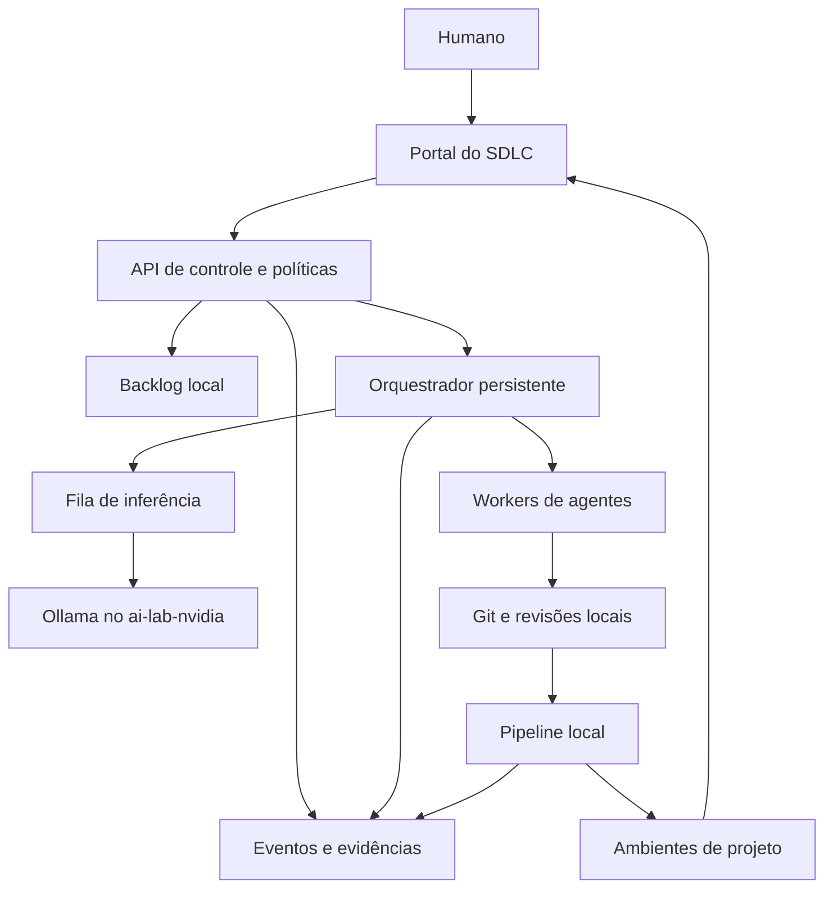

# Proposta de arquitetura: SDLC agêntico local

Status: proposta para avaliação; não autoriza provisionamento.
Data: 2026-10-14.

## 1. Objetivo e limites

Entregar aplicações web, agentes de IA e automações com orquestração de agentes mediante um ciclo rastreável: outcome, épicos, histórias, implementação, testes, segurança, banco, deploy, execução de testes e aceitação humana.

O usuário atua por requisitos, perguntas, aprovações, demonstrações e resultados. Código e logs técnicos permanecem disponíveis para investigação, mas não são a interface cotidiana. A plataforma não promete resolver autonomamente qualquer projeto: dúvida, falha recorrente ou risco fora da política deve gerar uma intervenção humana com evidências e opções concretas.

Tudo deve operar na workstation. Downloads são permitidos na preparação e instalação dos ambientes; execução normal deve funcionar sem acesso externo. A definição de uma nova dependência exige uma etapa explícita de preparação conectada antes de retornar à operação offline. Serviços externos eventualmente usados pelo produto precisam de substitutos locais no piloto.

## 2. Separação dos ambientes

- `ai-lab-nvidia`: permanece responsável pelos modelos e inferência. Não armazena o estado oficial do SDLC.
- `agentic-sdlc`: diretório `sdlc/` neste repositório, com setup e distro WSL próprios, com configurações, volumes, backups, atualização e remoção independentes.
- Projetos: repositórios no GitLab local do SDLC, com checkouts fora deste repositório, ambientes de construção descartáveis e bancos distintos para desenvolvimento, teste e publicação local.

A distribuição física exata depende do inventário de hardware. Uma distro distinta fornece separação operacional, mas não é uma fronteira suficiente contra código hostil. Para execução de comandos produzidos por agentes, avaliar workers em VM dedicada, sem compartilhamentos do host, antes de liberar tarefas irrestritas.

Contrato com o laboratório: endpoint de inferência configurável, health check, lista de modelos, limites de contexto e timeout. Somente o serviço de inferência da plataforma acessa o endpoint; trabalhadores não recebem acesso administrativo ao laboratório. A exposição necessária da API será uma mudança separada e revisável.

## 3. Componentes candidatos e decisão inicial

| Capacidade | Candidato | Decisão proposta |
| --- | --- | --- |
| Backlog, outcomes, épicos e histórias | OpenProject Community | Avaliar no piloto; testar hierarquia, campos, API e permissões na edição gratuita antes de depender deles |
| Git, revisões e pipelines | Forgejo + Forgejo Runner | Candidato principal para execução local; ações e dependências espelhadas localmente |
| Agentes com estado e intervenção | LangGraph OSS + PostgreSQL | Candidato principal para fluxos de agentes, checkpoints e interrupções |
| Controle do ciclo de entrega | API própria + estado persistente + worker determinístico | Necessário para aplicar políticas, agendar trabalhos, reconciliar falhas e integrar ferramentas |
| Interface cotidiana | Portal web próprio | Visão unificada de trabalho, perguntas, aprovações, evidências e aplicação em homologação |
| Evidências | PostgreSQL para metadados e volume de artefatos por hash | Começar simples, com exportação de manifestos; avaliar armazenamento de objetos quando necessário |
| Testes web | Playwright e framework de testes da aplicação | Candidatos a validar com o stack escolhido |
| Segurança | Semgrep, Gitleaks, Trivy e OWASP ZAP | Candidatos; confirmar regras, licenças e bases locais antes da implementação |
| Banco | PostgreSQL por ambiente e ferramenta de migração do projeto | Migrações versionadas e pipeline obrigatório |
| Inferência | Modelos já declarados no laboratório | Comparar desempenho e confiabilidade em tarefas controladas |

Essas ferramentas não formam uma plataforma integrada pronta. Conectores, portal, aplicação de políticas e cadeia de evidências exigem desenvolvimento. LangGraph será utilizado como biblioteca local; não haverá dependência de serviço hospedado de observabilidade ou execução.

A escolha de um framework de agentes não substitui um agendador: checkpoints não disparam trabalhos sozinhos. Um worker deverá reivindicar tarefas com lease, heartbeat e recuperação. Eventos para integrações serão publicados por outbox transacional; consumidores deverão aceitar entrega repetida sem duplicar efeitos.

Não incluir Kubernetes no piloto. Reavaliar um motor específico de workflows duráveis caso os requisitos de operação excedam o serviço de controle inicial.

## 4. Fluxo e pontos de aprovação

| Etapa | Produção automatizada | Aprovação ou condição de passagem |
| --- | --- | --- |
| Outcome | Resultado desejado, indicador, baseline e meta | Humano aprova valor e medida de sucesso |
| Épicos e histórias | Decomposição, dependências, critérios e riscos | Humano aprova escopo e critérios |
| Planejamento | Arquitetura, contratos, plano de testes, ameaças e migrações | Humano aprova decisões relevantes e limites de execução |
| Implementação | Código em branch, testes e migrações | Limites previamente aprovados; sem publicação direta |
| Validação | Testes, revisão, segurança e pacote de evidências | Gates determinísticos e revisão; exceções exigem decisão humana |
| Homologação | Deploy do artefato aprovado e testes pós-deploy | Política aprovada permite ambiente descartável; sem acesso ao banco publicado |
| Aceitação | Roteiro, demonstração e registro do resultado | Humano aceita ou rejeita comportamento observado |
| Publicação local | Plano de mudança, backup e promoção | Humano aprova release e migrações; pós-deploy precisa passar |
| Medição do outcome | Métricas locais da aplicação | Humano avalia resultado; entrega técnica não comprova outcome |

Estados de uma execução: planejada, pronta, em execução, aguardando humano, em validação, falhou, cancelada e concluída. A release tem estado próprio, separado da execução e da história.

O usuário pode comentar, pedir revisão, pausar ou cancelar em qualquer etapa pelo portal. Pausa é cooperativa: ações já em andamento podem terminar até um limite seguro. Cancelamento impede novos efeitos, encerra workers quando possível e registra o que já ocorreu. Deploy e migração devem definir trechos críticos e compensações; não se promete desfazer automaticamente toda ação.

## 5. Papéis e permissões

| Papel | Pode | Não pode |
| --- | --- | --- |
| Agente de produto | Propor outcomes, épicos e histórias | Aprovar escopo ou publicar |
| Agente de arquitetura | Propor contratos e planos | Alterar política e credenciais |
| Agente de desenvolvimento | Editar branch e executar ferramentas autorizadas | Fazer merge, acessar dados publicados ou implantar release |
| Agente de qualidade | Produzir cenários e avaliar resultados | Declarar aceitação humana |
| Agente de segurança | Analisar ameaças e findings | Aceitar risco por conta própria |
| Executor de pipeline | Rodar jobs fixados em ambiente controlado | Confiar em instruções de texto para ampliar privilégios |
| Executor de deploy | Promover artefato autorizado no destino aprovado | Selecionar outro artefato ou destino |
| Humano responsável | Aprovar, rejeitar e aceitar risco com justificativa | Alterar silenciosamente evidências anteriores |

Papéis distintos podem utilizar o mesmo modelo. Isso separa acesso e responsabilidades, mas não garante independência intelectual. Revisão por outro agente deve ser complementada por testes determinísticos e aprovação humana.

As ferramentas aplicam permissões fora do prompt. Agentes recebem tokens limitados e temporários; nenhum agente recebe o socket Docker do ambiente de controle, credenciais administrativas ou acesso amplo ao filesystem do Windows. Workers só montam a cópia necessária do projeto. Pipelines e arquivos de política alterados por agentes precisam de revisão antes de execução privilegiada.

## 6. Rastreabilidade e auditoria

Cadeia obrigatória:

`outcome → épico → história → critério → execução → commit → revisão → build → teste/finding → release → deploy → aceitação → medição`

Cada entidade possui ID estável e versão. No piloto, Forgejo será a fonte de verdade do backlog e dos commits/revisões; a API de controle será a fonte das execuções, políticas e aprovações. OpenProject poderá substituir o adaptador de backlog posteriormente. O portal apresenta projeções; não cria um segundo backlog independente.

Evento mínimo: ID, data UTC, ator, papel, projeto, execução, correlação, tipo de ação, estado anterior/posterior, versão da política, hashes dos artefatos, resultado e referência à evidência. Apresentar horários no fuso do usuário.

Registro de inferência: modelo e digest quando disponível, configuração, versão do prompt, entradas e saídas permitidas pela política, chamadas de ferramentas, tempos e falhas. Remover secrets e restringir dados sensíveis. Registrar razões explícitas e resultados observáveis, sem depender de raciocínio interno do modelo.

Aprovação: identidade, decisão, justificativa, instante, objeto/versionamento, hash do artefato, destino e versão da política. Alterar o objeto aprovado invalida a autorização pertinente. Reprovar ou revogar aprovação precisa bloquear jobs pendentes.

Logs serão somente de inclusão para as identidades de serviço, com encadeamento de hashes, manifestos e backups. Isso ajuda a detectar alterações; não fornece inviolabilidade contra o administrador da própria workstation. A governança tem esse limite de confiança explícito.

Padrão inicial: nenhuma exclusão automática de registros no piloto. Antes de ampliar uso, definir retenção de prompts, artefatos, backups e dados pessoais, incluindo descarte autorizado com trilha de auditoria.

## 7. Pipelines de qualidade, segurança e banco

Pipeline mínimo: verificar proveniência e dependências → lint/análise de tipos → testes unitários → integração em banco descartável → build → análise de secrets/código/dependências/imagem → SBOM → homologação → testes de interface e segurança dinâmica → pacote para aceitação.

Política inicial proposta: nenhum teste obrigatório falhando, nenhum secret detectado e nenhuma vulnerabilidade crítica ou alta sem exceção humana documentada e prazo. Isso não comprova ausência de vulnerabilidades. Medir cobertura por critérios de aceitação; evitar um percentual arbitrário como substituto de qualidade.

Pipeline de banco: migração versionada → criação do zero → atualização desde a versão anterior com dados representativos → validação de compatibilidade → backup/restauração ensaiados → aprovação se houver efeito destrutivo → migração e verificação pós-deploy. Nunca editar migração já aplicada para corrigir histórico.

Não presumir rollback SQL seguro. Preferir mudanças compatíveis e correção progressiva; restaurar backup pode perder dados recentes e requer decisão explícita. Registrar a estratégia de recuperação por release.

Para agentes de IA: conjuntos de avaliação locais versionados, sucesso de tarefas, aderência a ferramentas, tentativas de acesso indevido, prompt injection, vazamento de dados, limites de custo/tempo e intervenção humana. Avaliador baseado em LLM é evidência auxiliar.

Para orquestrações: reexecução, timeout, idempotência, compensação, falhas parciais, retomada e cancelamento. Testar que uma repetição não duplica efeitos externos ou alterações de banco.

## 8. Operação offline e capacidade

Preparação conectada: fixar versões e digests, baixar imagens/modelos, copiar ações do CI, preparar wheels/pacotes, navegadores de teste e bases de segurança; gerar manifesto de tudo necessário. Não usar referências de ações que resolvam para servidores externos durante o pipeline.

Operação: bloquear saída externa nas redes de execução, manter comunicação interna necessária e observar tentativas de saída. Desativar telemetria e integrações hospedadas dos componentes selecionados. Demonstrar um ciclo completo com internet indisponível, inclusive build em worker novo usando somente o armazenamento local.

Bases de vulnerabilidade envelhecem offline. Exibir data e versão em cada relatório; definir validade e renovação em janela de manutenção autorizada. Nenhum relatório deve sugerir conhecimento de vulnerabilidades posteriores ao snapshot.

Hardware informado pelo usuário: Intel Core Ultra 9 185H (2,50 GHz), 32 GB de RAM (31,5 GB utilizáveis), NVIDIA RTX 5000 Ada Generation Laptop GPU com 16 GB de VRAM. Disco com 201 GB usados de 1,86 TB, aproximadamente 1,66 TB livres conforme os valores informados. A premissa de GPU de 32 GB presente na documentação do laboratório não corresponde a esta workstation.

O piloto deverá caber em 32 GB de RAM mediante medição e redução de serviços. Não há garantia antecipada de capacidade para a composição completa. Começar com Forgejo, PostgreSQL, controle/orquestração e portal mínimo; usar issues locais como backlog inicial, com IDs e relações explícitas. Adiar OpenProject até avaliar consumo, preservando um adaptador de backlog para futura integração. Desligar Jupyter, ambientes dev e demais workloads dispensáveis durante o piloto, mediante etapa de operação autorizada.

Executar uma inferência por vez e um job pesado por vez, evitando sobrepor build, navegador de testes e scans quando houver pressão de memória. Estabelecer orçamento conjunto de RAM entre as distros WSL e o Windows; não configurar limites isolados supondo que cada distro tem acesso exclusivo à RAM disponível. Não alterar `.wslconfig` nesta etapa. Avaliar workers em VM considerando seu custo de memória; não dispensar isolamento para fazer o piloto caber.

Começar a avaliação com `qwen3:14b`, já declarado no laboratório, contexto pequeno e ferramentas limitadas. Verificar quantização, consumo real, uso de GPU/CPU, latência e acerto antes de escolhê-lo. Se necessário, preparar um modelo de código menor em uma janela conectada. `qwen3-coder:30b` deixa de ser a escolha inicial: não assumir residência integral em 16 GB de VRAM; offload pode consumir RAM e aumentar latência. Os diferentes papéis continuam possíveis usando um único modelo sequencialmente.

Reservar inicialmente 200–300 GB adicionais de SSD como orçamento de trabalho, sujeito à medição, com retenção limitada de imagens e artefatos e backup separado. O armazenamento informado oferece folga inicial; RAM e VRAM são as principais restrições a validar. Upgrade de RAM, se suportado pelo equipamento, poderá ampliar folga, mas não é condição para iniciar a prova enxuta. Antes de instalar, medir consumo ocioso do laboratório e do Windows e definir limites de memória, tempo e tentativas por tarefa.

Workstation única implica indisponibilidade de todos os serviços em falha do host. Backup em outro volume reduz alguns riscos; backup recuperável em mídia local externa é necessário para perda física. Ensaiar restauração antes de considerar o ambiente confiável.

## 9. Piloto proposto

Produto: aplicação web local para registrar solicitações, acompanhar status e consultar histórico, com dois papéis de acesso e banco PostgreSQL. Dados sintéticos. Stack da aplicação escolhida na especificação do piloto.

Outcome: permitir que o usuário conclua o ciclo de uma solicitação pela interface, com histórico consultável. Métrica e meta serão aprovadas na definição do produto.

Histórias iniciais: registrar solicitação; listar e filtrar; atualizar status com autorização; visualizar histórico. Cada uma terá cenários positivos, negativos e critérios aprovados.

O piloto precisa demonstrar:

1. Definição e aprovação de outcome, épico, histórias e plano pelo portal.
2. Implementação por agente sem edição manual de código no caminho bem-sucedido.
3. Testes e segurança executados localmente, com evidências ligadas aos critérios.
4. Migração testada, deploy em homologação, rejeição humana e correção rastreável.
5. Aceitação e promoção do mesmo artefato para publicação local.
6. Recusa de deploy sem aprovação ou com hash divergente.
7. Pausa, cancelamento e retomada após reinício sem duplicar efeitos.
8. Restauração de backup e consulta da cadeia completa de auditoria.
9. Ciclo completo offline, sem chamadas a serviços externos.

Após o ciclo web, adicionar uma história com agente de IA e uma orquestração com falha simulada e compensação. Essas extensões validam os outros dois tipos de projeto antes de declarar a plataforma adequada aos três.

## 10. Ordem de entrega e decisões pendentes

Etapa A: avaliar esta arquitetura e confirmar hardware, papéis humanos, regra de conectividade e produto piloto.

Etapa B: implementar em `sdlc/` a especificação: contratos, schemas, estados, políticas, APIs, manifesto offline e setup revisável. Validar versões/licenças dos candidatos e sua integração mínima. Sem provisionar antes da revisão do plano de instalação.

Etapa C: provisionar serviços locais e executar primeiro um fluxo determinístico com aprovações, eventos e artefatos; depois integrar agentes. Isso permite testar a governança antes de conceder ferramentas ao modelo.

Etapa D: executar o piloto completo e medir desempenho, intervenção humana, confiabilidade e recuperação. Ampliar automação conforme evidência.

Decisões a confirmar: uma pessoa acumulando papéis ou múltiplos usuários; publicação exclusivamente local; janelas conectadas para novas dependências; mídia de backup; uso de VM para workers; aceitação do desenvolvimento da camada própria de controle e portal. Hardware informado acima; desempenho e capacidade permanecem sujeitos à medição.

Não há estimativa de prazo até concluir o inventário e o escopo implementável. O setup do SDLC residirá em `sdlc/`; o laboratório em `lab/` e os produtos exclusivamente no GitLab local do SDLC, fora deste repositório.

## 11. Fontes primárias consultadas

- [OpenProject: instalação Docker Community](https://www.openproject.org/docs/installation-and-operations/installation/docker/): opção autohospedada; capacidades necessárias serão verificadas na edição escolhida.
- [Forgejo Actions: administração](https://forgejo.org/docs/latest/admin/actions/): runners e configuração local de Actions.
- [Forgejo Actions: referência](https://forgejo.org/docs/v17.0/user/actions/reference/): ações remotas podem gerar downloads; preparar referências locais.
- [LangGraph: persistência](https://docs.langchain.com/oss/python/langgraph/persistence): checkpoints e armazenamento persistente.
- [LangGraph: interrupções](https://docs.langchain.com/oss/python/langgraph/interrupts): pausa para entrada humana e retomada; efeitos anteriores à interrupção precisam tolerar repetição.

As decisões de arquitetura, estimativas de capacidade e controles acima são recomendações desta proposta, não garantias dos fornecedores.
